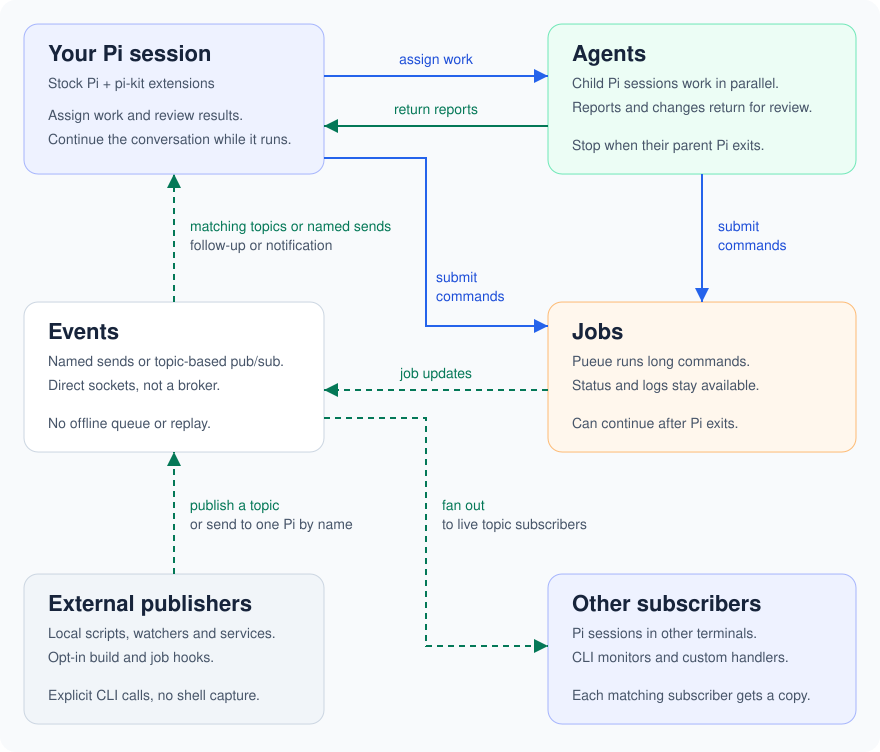

# pi-kit

Extensions and command-line tools for [Pi](https://github.com/earendil-works/pi).
Delegate work to child agents, run long commands through Pueue, and receive
completion notifications in your conversation. Pi itself stays unmodified.

Local scripts and service hooks can publish topics too. One broadcast can reach
multiple live Pi sessions or terminal subscribers; named sends target one Pi.

Agents stop when Pi exits. Jobs can continue; live watches end with Pi and missed
notifications are not replayed. Reopen the original session to inspect or rewatch jobs.

Nix packages and NixOS/nix-darwin modules are included. Components are enabled
individually. Linux is tested; native Darwin validation is pending.

[Setup](docs/usage.md) · [MIT license](LICENSE)
