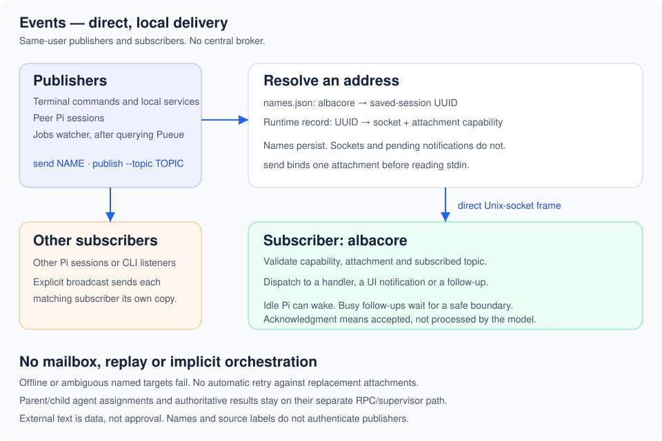

# Events

[Setup](../../docs/usage.md)

## Friendly session addresses

Each Pi session gets a short address such as `albacore`, `miso` or `clover`.
Status places it at the right of the prompt's top border; without Status, it appears
in Pi's normal extension status area. `/events` shows the address and topics.
`/events rename NAME` changes the address, not Pi's conversation title (`/name`).
Names are normalized to lowercase and use 2–24 letters, digits or single hyphens,
starting with a letter. Renaming to another session's reserved name is refused.

Reservations map Pi session UUIDs to names in
`$XDG_STATE_HOME/pi-kit/events/names.json` (default
`~/.local/state/pi-kit/events/names.json`). This private JSON file is the sole
authority: updates use a bounded file lock and atomic replacement. Resume and
reload keep the name; a fork with a new UUID gets a new name. Closing a session
retains its reservation. Renaming releases the old name. Names are unique within
this user's state directory, including offline sessions; there is no automatic
pruning. Corrupt registries are reported, never silently replaced. Unavailable
name storage does not disable existing UUID-based event delivery.

```sh
pi-events list                 # advertised subscribers and their names (JSON)
pi-events list --all           # also include reserved names with no subscriber
printf 'Build finished\n' | pi-events send albacore
```

`send NAME` reads nonempty UTF-8 text and publishes `session.message` to exactly
one advertised Pi attachment. It resolves the name and attachment **before**
reading stdin. A pipeline cannot silently follow a replacement attachment or a
reassigned name. Unknown names, offline/unsubscribed sessions and multiple matching
advertisements fail explicitly. Stale advertisements can cause refusal too;
listing is not a liveness check. In `list --all`, `id: null` means no advertised
subscriber. No capability tokens are printed.

An idle live Pi can start a turn from `send`; a busy Pi uses the existing bounded
follow-up delivery. Acceptance is not proof that the model processed the text.
Messages are never queued on disk or replayed when a session resumes. `send`
rejects text beyond Pi's 8,192 UTF-16-unit message-content limit or the wire byte
limit rather than silently shortening it. For large logs, send a path and a
bounded excerpt. Like any pipeline, an early receiver failure can close stdin;
use Jobs for execution that must outlive its receiver.

Shell and terminal capture stay outside this extension. Users can pipe output
from their own helpers into `send`; Events does not record shell history, recover
old stdout, or rerun commands.

## Commands and transport

| CLI command                            | Purpose                                                                 |
| -------------------------------------- | ----------------------------------------------------------------------- |
| `send NAME`                            | Plaintext to one named Pi session                                       |
| `list [--all]`                         | Advertisements, plus optional offline reservations                      |
| `publish --topic TOPIC`                | Explicit JSON payloads, plaintext with `--text`, targeting or broadcast |
| `subscribe --session ID --topic TOPIC` | Print matching events until stopped                                     |


Publishers contact subscriber sockets directly; there is no Events broker.
Stock Pi's `pi.events` is a separate in-process extension bus. Agents' assignments
and authoritative results use their RPC/supervisor path, not this transport.

The Pi extension subscribes to `session.message`, `job.completed`, `job.progress`, `agent.result`, `agent.question`, `agent.reply`, and `agent.progress`. Progress produces UI notifications; results and questions request follow-up turns. These topic names are conventions, not built-in subagent orchestration.

Busy-session follow-ups stay in memory until Pi would settle and share one continuation. They are held rather than queued in Pi because Pi's follow-up queue is irrevocable, and a tool later in the turn may read the same result; the cost is that unread notices arrive after the turn, as one batch. For `job.completed` from `pi-jobs`, a Bash result showing the job's terminal state suppresses the pending notification: a `pi-jobs status` line or JSON row with the same handle, owner, state and exit code, or the `job=HANDLE STATE exit=CODE` line that `pi-jobs wait` and `pi-jobs log` print on stderr once the job has finished. A command string, running status, wait timeout or mismatched incarnation does not. Unknown output formats keep the notification rather than risk losing a result. The model receives a short form: the status line, at most 12 log lines with build chatter (for example cargo `Compiling` and nix dirty-tree warnings) removed, and the `pi-jobs log HANDLE` hint. The TUI shows a one-line card with a status glyph, the job name, and dimmed exit code, elapsed time and handle, plus a few relevant lines; Ctrl+O expands the full retained tail. Escape or an error does not restart the model; pending notices can be delivered on a later successful turn. Reload and session replacement discard pending notices without replay.

Messages have compact, theme-aware previews. Ctrl+O expands the original message. Job previews show the name, protected handle and terminal outcome; this also works when reopening saved sessions.

```sh
printf '%s' '{"text":"Review finished","path":"/tmp/review.md"}' \
  | pi-events publish --topic agent.result --source reviewer --to SESSION
```

For plaintext stdin, use an explicit flag:

```sh
printf 'Build finished\n' \
  | pi-events publish --topic agent.result --text --to SESSION
```

`--text` wraps nonempty UTF-8 stdin in `{"text": "..."}` and preserves newlines. The default still parses JSON; it never guesses the input format. Sockets always carry JSON, not raw text.

Inside Pi, the current session and attachment generation are supplied automatically. Outside Pi, use `--to SESSION` or explicitly choose `--broadcast`. Each matching subscriber receives its own copy. `job.watch`, `job.unwatch`, and the daemon's `job.changed` signals are control topics registered by the jobs extension; they do not directly wake the model.

A terminal can subscribe too:

```sh
pi-events subscribe --session monitor --topic 'job.*'
```

Use `/events` to list Pi topics, `/events subscribe ci.completed followUp` to wake the model for a new topic, or `/events subscribe ci.progress display` for notifications. `/events unsubscribe TOPIC` removes a user subscription. Other Pi extensions can register a handler with `pi.events.emit("pi-events:subscribe", { topic, handler })`; handlers receive `(event, signal)` and must check the `AbortSignal` before any side effect after an `await`. Dispatch has a 1.5-second deadline and at most 32 in-flight connections/frames. Expired queued frames are discarded; an unresolved handler cannot block other handlers or shutdown and is not reentered until it settles. Arbitrary extension code cannot be forcibly cancelled or sandboxed; ignoring the signal can still cause late side effects. Built-in jobs handlers honor cancellation and abort only their status-query client, not the job.

Sockets and subscription records live in a private `$XDG_RUNTIME_DIR/pi-events` directory. An attachment has a random ID and capability. The current attachment ID is exported as `PI_EVENTS_SUBSCRIPTION`; inherited publishers cannot accidentally send to a replacement attachment after Pi restarts. Explicit cross-session sends resolve the currently advertised subscribers. Stale records can remain after a crash, but failed sockets do not count as delivery. `pi-events list` lists records, not a liveness guarantee.

Publishing prints counts of matched and accepting subscribers plus at most eight errors and an `errors_omitted` count. One publish attempts at most 64 subscribers with a four-second overall socket-I/O deadline. `limited: true` means fan-out stopped early and the counts are partial. This is intended for a few live sessions, not a general event bus. The Python terminal subscriber applies normal stdout backpressure; a slow reader can prevent it from accepting more events. Exit 0 means at least one subscriber acknowledged acceptance; exit 3 means none acknowledged it. After a timeout, delivery may have happened without an acknowledgment. Partial fan-out is reported. Acceptance is not proof that a model processed the event. There is no automatic retry, disk spool, or offline replay. Live subscribers suppress repeated IDs within a bounded 256-event window and reject conflicting content under the same ID.

The wire frame is `{version: 1, subscription, token, event}`; the event is `{version: 1, id, topic, source, payload}`. IDs are 32 lowercase hex characters. Wire bytes must be UTF-8; lone Unicode surrogates and nonfinite numbers are rejected. Integral numbers must be within `±9007199254740991`; use strings for larger integers. Python and TypeScript implementations share conformance fixtures in `src/events/protocol.json` for fields, byte limits, routing, capabilities, and duplicate identity.

The Pi adapter allows at most 32 uncommitted follow-ups and 64 subscribed topics. Frames are limited to 16 KiB; compact UTF-8 events to 15 KiB. Incoming text is external data, not instructions or approval. Processes running as the same Unix user are trusted; `source` labels do not authenticate an agent. Do not publish secrets. Questions and replies carry whatever correlation fields your producer needs, but pausing and resuming a worker remains the producer's responsibility.
